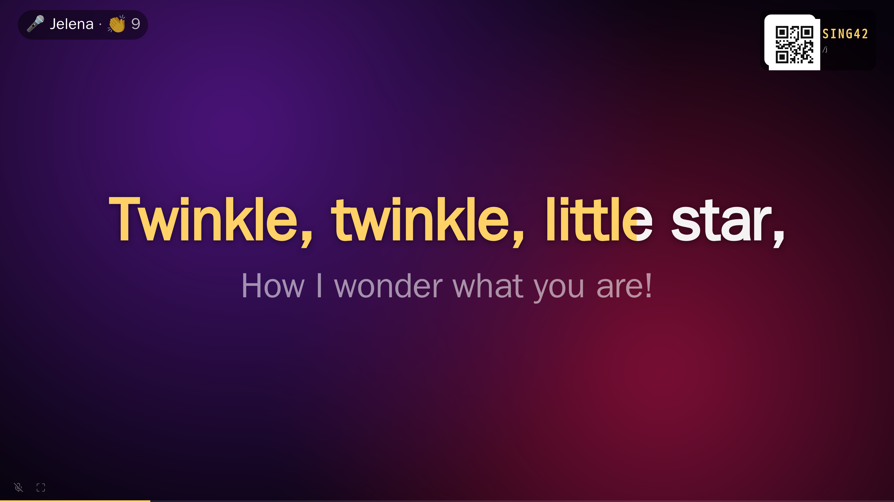
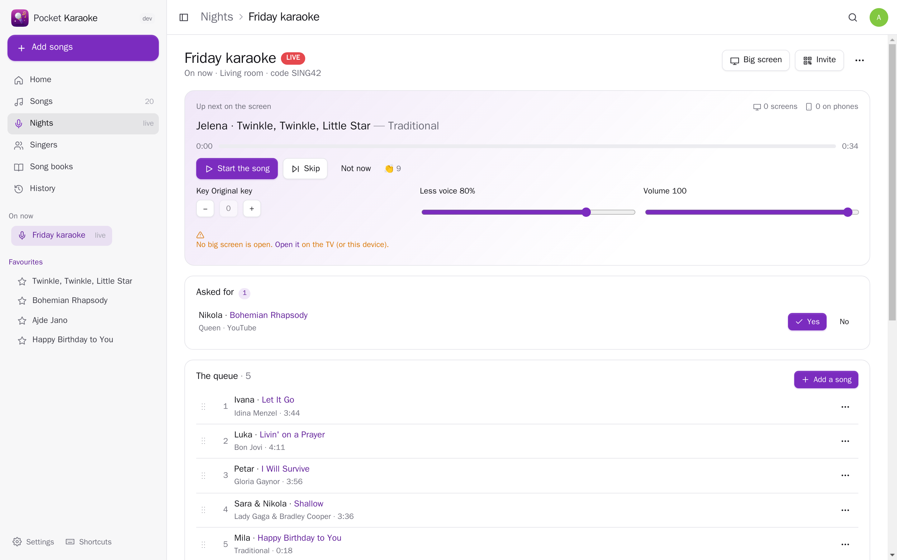
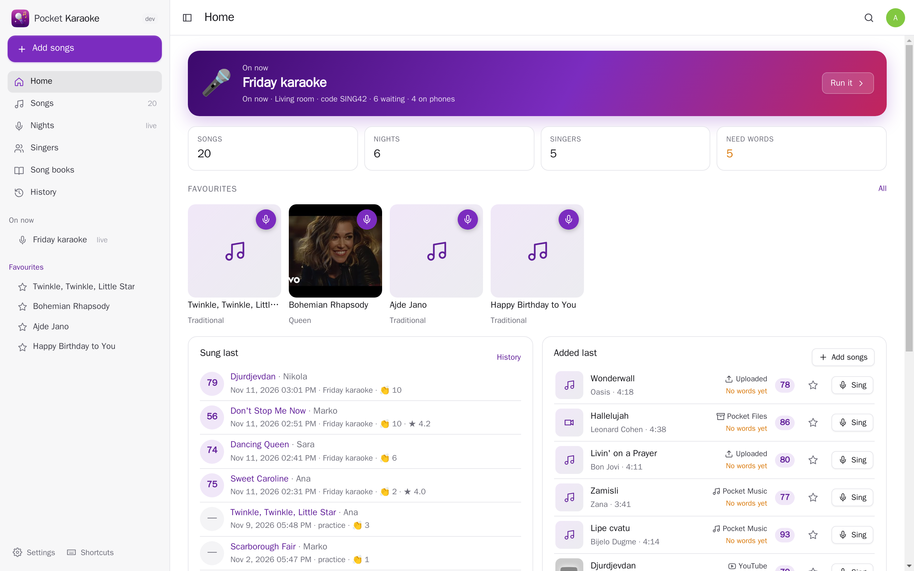
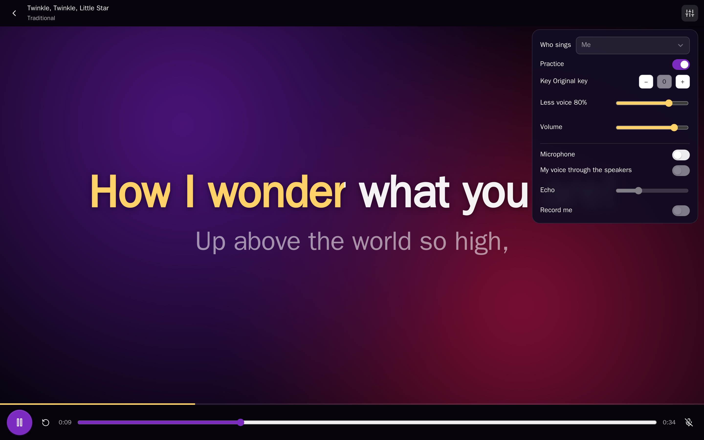
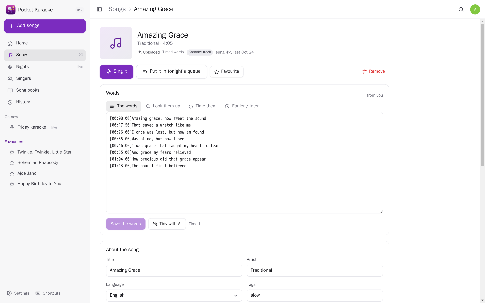
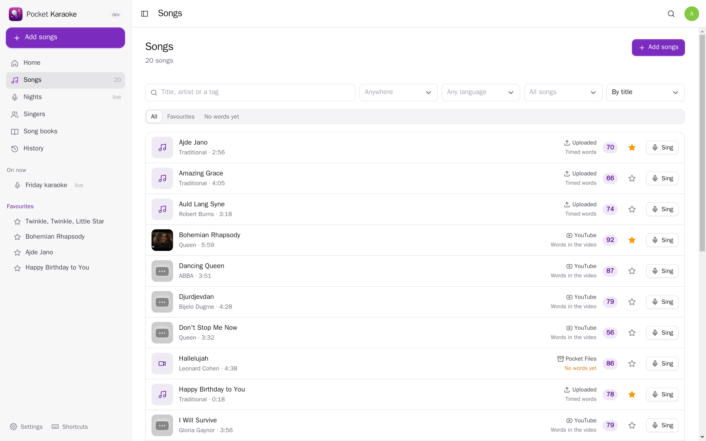
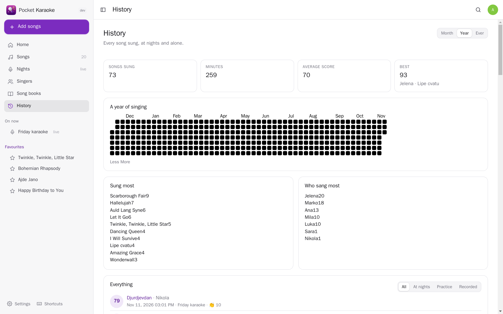
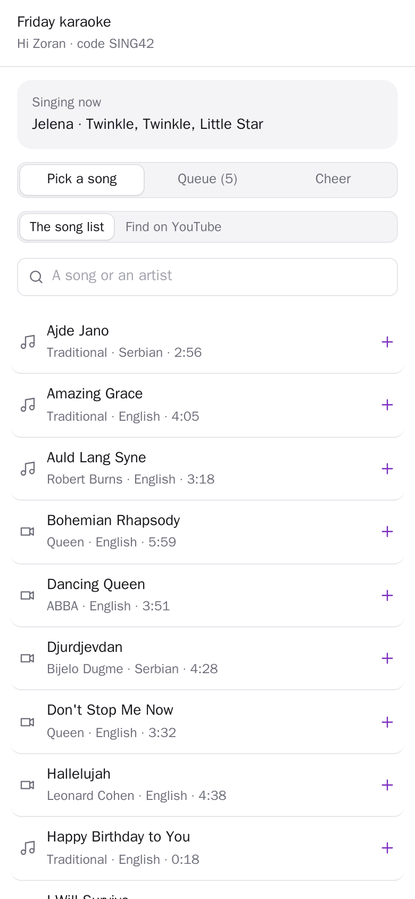
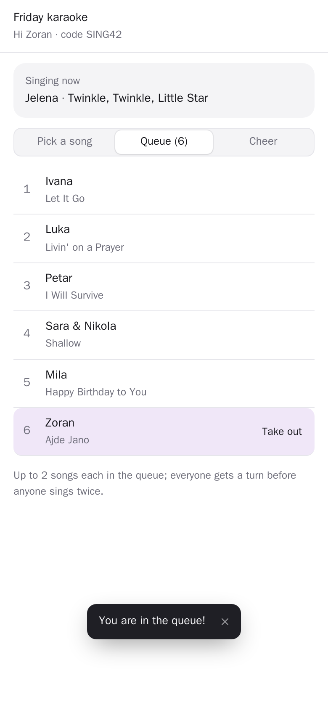
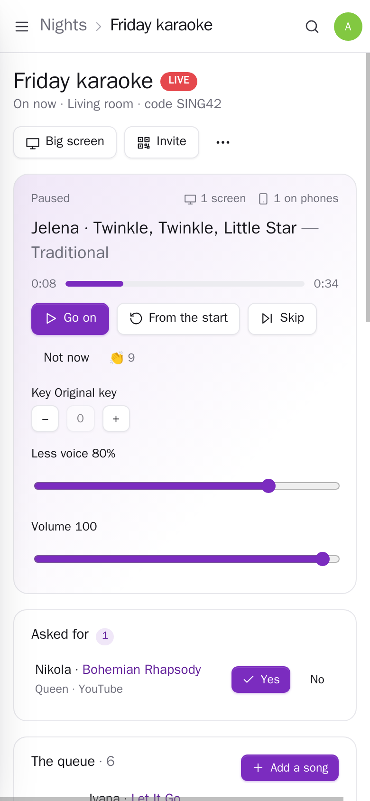

<p align="center"></p>
<h1 align="center">Pocket Karaoke</h1>
<p align="center">Karaoke at home: sing songs from your own files, YouTube or Pocket Music with the words lighting up as you sing — in another key, with less of the singer’s voice, your voice through the speakers and a score for fun — or run a karaoke night where the TV plays the queue and everyone picks songs on their phone.<br>One Go binary, one SQLite file, one volume. Part of the Pocket apps; works on its own too.</p>
<p align="center">
  <a href="https://github.com/abjelosevic88/pocket-homelab-karaoke/actions"></a>
  <a href="https://github.com/abjelosevic88/pocket-homelab-karaoke/pkgs/container/pocket-homelab-karaoke"></a>
  <a href="LICENSE"></a>
</p>

---

<p align="center"></p>

<table>
  <tr>
    <td width="50%"></td>
    <td width="50%"></td>
  </tr>
  <tr>
    <td align="center"><sub>Running a night: what is on the big screen, key and voice, songs asked for, the queue.</sub></td>
    <td align="center"><sub>Home: the night on now, favourites, what was sung last.</sub></td>
  </tr>
  <tr>
    <td width="50%"></td>
    <td width="50%"></td>
  </tr>
  <tr>
    <td align="center"><sub>Sing on this device: key, less voice, microphone with echo, a score and a recording.</sub></td>
    <td align="center"><sub>A song: timed words looked up on LRCLIB or tapped in time, moved earlier or later.</sub></td>
  </tr>
  <tr>
    <td width="50%"></td>
    <td width="50%"></td>
  </tr>
  <tr>
    <td align="center"><sub>Songs from uploads, YouTube, Pocket Music and Pocket Files, with song books.</sub></td>
    <td align="center"><sub>History: a year of singing, the most sung songs and singers.</sub></td>
  </tr>
</table>

<p align="center">
  &nbsp;&nbsp;
  &nbsp;&nbsp;
  
</p>

## What it does

**Songs from anywhere**
- **Upload** MP3, M4A, OGG, FLAC, WAV, MP4 or WebM — with an `.lrc` beside it for timed words, or a `.cdg` for classic karaoke discs (MP3+G, drawn on the screen as the disc would). A `.zip` of them works too. Title, artist, length and picture come from the file.
- **YouTube**: search right in the app (it adds “karaoke” for you) or paste a link. Videos play in YouTube’s own player; keep a copy on the server (yt-dlp) to sing without YouTube, change the key and record.
- **Pocket Music**: sing your own library — played from there, with the timed words it already has.
- **Pocket Files**, a link to a song file on the web, or just the words to start with.

**The words**
- Looked up on [LRCLIB](https://lrclib.net) (free, timed) when a song comes in, or chosen from the matches yourself.
- Paste them and **tap in time** while the song plays (space bar per line); move them all earlier or later by tenths of a second.
- Word by word (enhanced LRC) or line by line, a count-in before the first words, the next line below, and a **translation** under each line (Pocket Translate).
- Pocket AI tidies words pasted from a web page (chords, headings and junk out) — it never writes words itself.

**Singing**
- **Key** −6…+6 semitones while it plays, **less voice** (the middle of the stereo picture, in the voice’s range), volume.
- The **microphone**: your voice through the speakers with echo, the notes you sing drawn along the bottom, and a **score for fun** (singing on time and held notes — it does not know the melody, and says so).
- **Record** yourself with the song; listen back, keep it in Pocket Files.

**Karaoke nights**
- The **big screen** (a TV, a projector, a laptop) opens with its own link — no sign-in: “up next”, a countdown, the song with its words, the score, cheers floating up, photos between songs (Pocket Photos).
- **Guests join on their phones** with a six-letter code or the QR code — no account, just a name. They pick from the song list (or a song book you chose for the night), search YouTube when you allow it, see their place, cheer and give stars.
- **The queue** goes round fairly (nobody sings twice before everyone had a turn) or in the order asked; drag to change it, say yes to each request if you like, a limit per guest, pause a guest.
- The host’s page runs it from any phone: start, pause, from the start, skip, not now, key, less voice, volume.
- After the night: the podium, the most cheered, results to Pocket Chat, a Pocket Music playlist of what was sung.

**And** singers with their stats, song books, a history with a year of singing, favourites, search by a line of the words, JSON export/import and CSV.

## Works with the other Pocket apps

All optional, each switched on per person (Pocket Core → Links, or directly with a URL and token):

| App | What for |
|---|---|
| Pocket Music | Sing songs from your library (new `music:play` link); a playlist of each night |
| Pocket Files | Bring songs in (with their .cdg/.lrc); keep recordings |
| Pocket Photos | An album on the big screen between songs |
| Pocket Calendar | A planned night in your calendar, with the join link |
| Pocket Chat | Send the invitation and the results |
| Pocket Contacts | Singers from your address book |
| Pocket Translate | Each line in your language |
| Pocket Habits | Tick a singing habit when you practise |
| Pocket Alerts | The day before a night |

Karaoke offers `karaoke:read` and `karaoke:write` to the rest of the box (Pocket Day, Search, AI — “put Dancing Queen on for Ana”), and publishes `karaoke.song_added`, `night_planned`, `night_started`, `performed`, `night_ended`. Pocket AI (through Core, or your own OpenAI key) tidies words and suggests songs from your own library for the room.

## Run it

```sh
docker run -d --name pocket-karaoke -p 8080:8080 -v ./data:/data \
  -e BASE_URL=http://karaoke.local:8080 -e ADMIN_EMAIL=you@example.com -e ADMIN_PASSWORD=change-me \
  ghcr.io/abjelosevic88/pocket-homelab-karaoke:latest
```

Or [docker-compose.yml](docker-compose.yml), or a release binary (`pocket-karaoke`; without ffmpeg/yt-dlp it still works — songs come in without their picture, YouTube plays in YouTube’s player). `make run` starts it with demo data and no login.

Guests’ phones need to reach `BASE_URL` (the QR code points there) — on your home network that is the usual case.

- [Configuration](docs/configuration.md) · [API](docs/api.md) · [Backup](docs/backup.md) · [Reverse proxy](docs/reverse-proxy.md)

## Develop

`make dev` (API on :8080, Vite on :5173), `make test` (go vet, go test, tsc). Go 1.26, React 19, TypeScript, Vite; SQLite through modernc (no CGO). The key changer is an AudioWorklet (`web/public/pitch-shifter.js`), CD+G is drawn by `web/src/lib/cdg.ts`, LRC is read in both Go and TypeScript.

MIT © 2026 Aleksandar Bjelosevic
